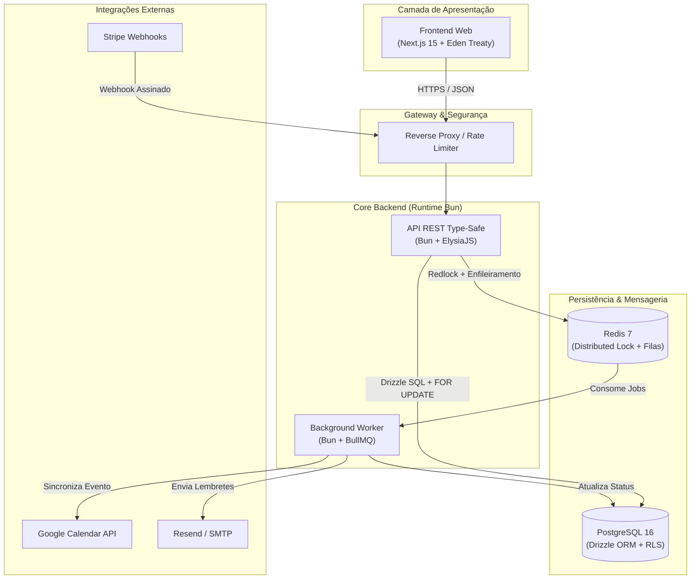
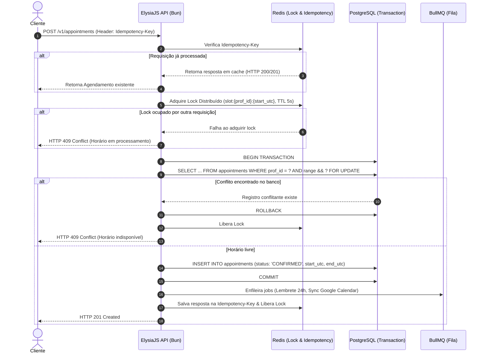
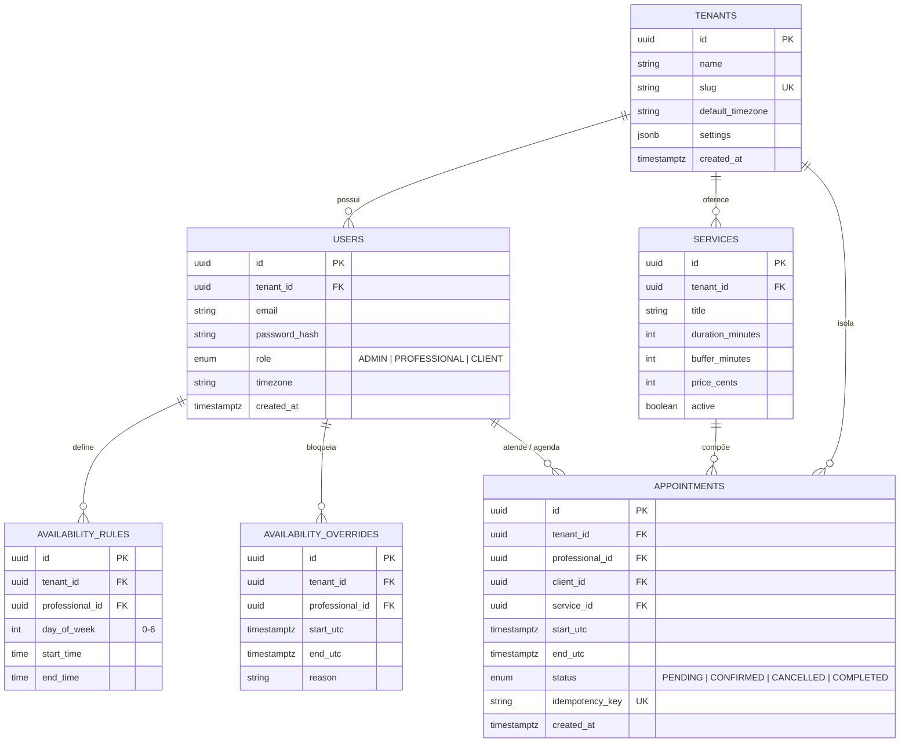

# 🗓️ ChronoFlow — Plataforma de Agendamento Multi-tenant (Stack TypeScript / Bun)

[](https://www.typescriptlang.org/)
[](https://bun.sh/)
[](https://elysiajs.com/)
[](https://www.postgresql.org/)
[](https://redis.io/)

> **Plataforma SaaS B2B/B2C de agendamentos de alta disponibilidade**, projetada com foco em isolamento de dados (*Multi-tenancy*), prevenção rigorosa de condições de corrida (*Race Conditions*), manipulação determinística de fusos horários e processamento assíncrono em alta velocidade sobre o runtime **Bun**.

---

## 📋 Índice

- [1. Visão Geral e Problema Resolvido](#-1-visão-geral-e-problema-resolvido)
- [2. Arquitetura do Sistema](#-2-arquitetura-do-sistema)
- [3. Fluxo Crítico de Reserva (Concorrência e Idempotência)](#-3-fluxo-crítico-de-reserva-concorrência-e-idempotência)
- [4. Modelagem do Banco de Dados (DER)](#-4-modelagem-do-banco-de-dados-der)
- [5. Stack Tecnológica](#-5-stack-tecnológica)
- [6. Architecture Decision Records (ADRs)](#-6-architecture-decision-records-adrs)
- [7. Estrutura do Projeto (Monorepo Bun Workspaces)](#-7-estrutura-do-projeto-monorepo-bun-workspaces)
- [8. Setup Local e Execução](#-8-setup-local-e-execução)
- [9. Testes Automatizados e Engenharia](#-9-testes-automatizados-e-engenharia)

---

## 🎯 1. Visão Geral e Problema Resolvido

Sistemas de agendamento em produção enfrentam desafios críticos que vão muito além de operações CRUD tradicionais:
1. **Double Booking (Concorrência):** Dois clientes tentando reservar o último horário disponível no mesmo milissegundo.
2. **Armadilhas de Fuso Horário & Horário de Verão:** Profissionais e clientes operando em regiões diferentes com regras dinâmicas de DST (*Daylight Saving Time*).
3. **Vazamento de Dados entre Tenants:** Risco de uma clínica/empresa visualizar ou alterar agendas de outra organização.
4. **Resiliência em Notificações e Pagamentos:** Falhas de rede em provedores de e-mail, WhatsApp ou gateways de pagamento (webhooks duplicados).

---

## 🏗️ 2. Arquitetura do Sistema

A aplicação é organizada como um **Monorepo nativo via Bun Workspaces**, compartilhando contratos de tipagem *End-to-End* (via **Eden Treaty**) entre o frontend Next.js, a API ElysiaJS e os Workers assíncronos.



---

## ⚡ 3. Fluxo Crítico de Reserva (Concorrência e Idempotência)

O diagrama abaixo ilustra como a API garante **zero double-booking** mesmo sob rajadas de requisições simultâneas para o mesmo slot:



---

## 🗄️ 4. Modelagem do Banco de Dados (DER)

Todos os timestamps são persistidos exclusivamente em **UTC (`TIMESTAMPTZ`)**, enquanto a intenção original de calendário (ex: `America/Sao_Paulo`) é preservada no perfil do tenant/profissional.



---

## 🛠️ 5. Stack Tecnológica

| Camada | Tecnologia | Papel na Arquitetura |
| :--- | :--- | :--- |
| **Runtime & Package Manager** | **Bun 1.x** | Execução nativa de TypeScript sem transpilação prévia, `bun install` ultrarrápido e test runner nativo (`bun test`). |
| **Backend Framework** | **ElysiaJS** | Framework web ergonômico otimizado para Bun, com validação de schema em tempo de execução (TypeBox) e documentação OpenAPI/Swagger automática. |
| **End-to-End Type Safety** | **Eden Treaty** | Cliente RPC type-safe que permite ao frontend consumir rotas do ElysiaJS com autocomplete total sem geração de código. |
| **Banco de Dados & ORM** | **PostgreSQL 16 + Drizzle ORM** | Consultas SQL performáticas e type-safe, suporte nativo a `TSTZRANGE` e `EXCLUDE USING GIST` para integridade temporal. |
| **Filas & Cache** | **Redis 7 + BullMQ** | Processamento assíncrono com *retries* exponenciais, *Dead Letter Queues* (DLQ) e bloqueio distribuído. |
| **Autenticação** | **JWT (Jose) + Bun.password** | Hashing nativo de senhas via Argon2id (`Bun.password.hash`) e tokens de curta duração com Refresh Token rotativo. |
| **Frontend** | **Next.js 15 (App Router) + Tailwind CSS** | Interface responsiva com *Optimistic UI* e renderização híbrida. |
| **Observabilidade** | **Pino + OpenTelemetry** | Logs estruturados em JSON com `correlationId` por requisição e rastreamento distribuído. |

---

## 🧠 6. Architecture Decision Records (ADRs)

### ADR-001: Por que Bun + ElysiaJS em vez de Node.js + Express/NestJS?
* **Contexto:** Precisamos de baixa latência na validação de disponibilidade de slots (cálculo intensivo de intervalos de datas) e segurança estrita de tipos entre backend e frontend.
* **Decisão:** Adotar **Bun** como runtime e **ElysiaJS** como framework HTTP.
* **Consequências:** Redução significativa no tempo de cold-start e overhead de serialização JSON; uso de APIs nativas rápidas (`Bun.password`, `Bun.sql` / driver `postgres.js`) e inferência de tipos automática via Eden Treaty.

### ADR-002: Defesa em Profundidade contra Double-Booking
* **Contexto:** Apenas validar `if (slotIsFree)` na aplicação falha sob alta concorrência.
* **Decisão:** Aplicar três camadas de proteção:
  1. **Redis Distributed Lock:** Rejeita imediatamente requisições concorrentes para o mesmo profissional/horário antes de tocar no banco.
  2. **Pessimistic Locking (`FOR UPDATE`):** Serializa transações concorrentes no PostgreSQL.
  3. **Constraint `EXCLUDE USING GIST`:** Garante no nível do motor do banco de dados que dois agendamentos ativos (`status != 'CANCELLED'`) nunca possuam interseção de intervalo (`tstzrange(start_utc, end_utc)`) para o mesmo `professional_id`.

### ADR-003: Isolamento Multi-tenant via Contexto de Requisição + RLS
* **Contexto:** Dados de múltiplos clientes coexistem no mesmo banco PostgreSQL.
* **Decisão:** Toda requisição autenticada injeta `tenantId` via plugin de escopo do ElysiaJS e configura `SET LOCAL app.current_tenant_id = '...'` na transação do PostgreSQL, ativando políticas de **Row-Level Security (RLS)** como rede de segurança contra esquecimento de cláusulas `WHERE tenant_id = ?`.

---

## 📂 7. Estrutura do Projeto (Monorepo Bun Workspaces)

```text
chronoflow/
├── apps/
│   ├── api/                        # Servidor HTTP ElysiaJS (Bun)
│   │   ├── src/
│   │   │   ├── modules/            # Domínios (auth, tenants, availability, appointments)
│   │   │   ├── shared/             # Plugins Elysia (RLS, AuthGuard, ErrorHandler, Logger)
│   │   │   ├── index.ts            # Entrypoint da API
│   │   │   └── app.ts              # Instância exportada para testes de integração
│   │   └── tests/                  # Testes unitários e de concorrência (bun test)
│   ├── worker/                     # Consumidor BullMQ rodando em Bun
│   │   └── src/
│   │       ├── processors/         # EmailReminder, GoogleCalendarSync, StripeWebhook
│   │       └── index.ts
│   └── web/                        # Frontend Next.js 15
├── packages/
│   ├── db/                         # Drizzle ORM schemas, migrations e seeds
│   └── shared-types/               # Tipos e constantes compartilhadas
├── docker-compose.yml              # PostgreSQL 16, Redis 7, Mailpit e Adminer
├── package.json                    # Configuração de Bun Workspaces
└── bunfig.toml                     # Configurações do runtime e test runner Bun
```

---

## 🚀 8. Setup Local e Execução

### Pré-requisitos
* [Bun](https://bun.sh/) `>= 1.1.0`
* [Docker](https://www.docker.com/) e Docker Compose

### Passo a Passo

```bash
# 1. Clone o repositório
git clone https://github.com/seu-usuario/chronoflow.git
cd chronoflow

# 2. Instale as dependências de todo o monorepo com Bun
bun install

# 3. Configure as variáveis de ambiente
cp .env.example .env

# 4. Suba a infraestrutura (PostgreSQL 16, Redis 7 e Mailpit para captura de e-mails)
docker compose up -d

# 5. Execute as migrations e popule o banco com dados iniciais (tenants, profissionais e serviços)
bun run db:migrate
bun run db:seed

# 6. Inicie a API, o Worker e o Frontend simultaneamente em modo watch
bun run dev
```

* **API Swagger / Scalar Docs:** `http://localhost:3000/swagger`
* **Frontend Web:** `http://localhost:3001`
* **Mailpit (Caixa de entrada local):** `http://localhost:8025`

---

## 🧪 9. Testes Automatizados e Engenharia

O projeto utiliza o test runner nativo do Bun (`bun test`) combinado com **Testcontainers** para validar regras críticas contra instâncias reais de PostgreSQL e Redis:

```bash
# Rodar todos os testes unitários
bun test

# Rodar suite de testes de integração e estresse de concorrência
bun test:integration
```

### Cenários Obrigatórios Cobertos na Suite:
- [x] **Teste de Concorrência (Race Condition):** Disparo paralelo (`Promise.allSettled`) de **50 requisições simultâneas** para o mesmo horário e profissional — garantindo exatamente `1` status `201 Created` e `49` status `409 Conflict`.
- [x] **Teste de Transição de Horário de Verão (DST):** Criação de agendamentos recorrentes na semana de mudança de fuso em `America/New_York` e `Europe/London`.
- [x] **Teste de Vazamento Multi-tenant:** Tentativa de leitura/cancelamento de agendamento do `Tenant A` utilizando token JWT válido do `Tenant B` (deve retornar `404 Not Found`).
- [x] **Teste de Idempotência:** Reenvio de webhook do Stripe com o mesmo `event.id` garantindo que o processamento ocorra apenas uma vez.
